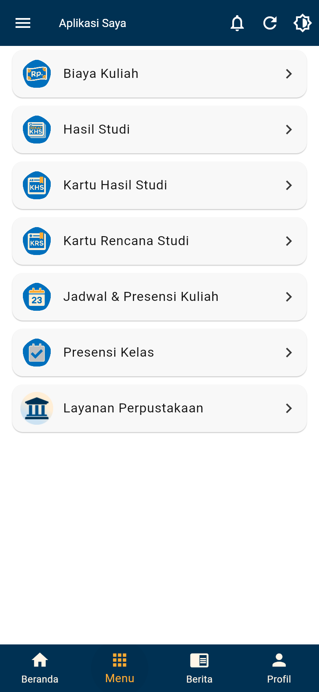

# Gapura UB Rebuilt

Unofficial Flutter reconstruction of **Gapura UB 3.3.38 (version code 194)**. It includes a student-focused live-service path and a credential-free local preview for five roles. The preview uses synthetic records; the live student path can read UB services through the official-dashboard session bridge.

**Work in progress:** complete 1:1 UI, native authentication, all-role live behavior, original architecture and dependency parity are unfinished. The role preview does not establish original runtime or pixel parity. Presensi viewing has been checked with a real account; attendance and survey submission are implemented but have not been submitted to the live backend. See [documented progress](docs/PROGRESS.md) and [architecture](docs/ARCHITECTURE.md).



For a guest preview with synthetic records and selectable data states, see the [guest preview guide](docs/GUEST-PREVIEW.md). For the five-role preview and its four data states, see [Local role demo](docs/ROLE-DEMO.md).

The app starts on a welcome screen with guest access, UB account sign-in, and local Tendik, Dosen, and Orangtua examples. Local role examples use fictional in-memory data and do not sign in to UB services.

## Prerequisites

- **Flutter 3.35.3 / Dart 3.9.2**, pinned in `.fvmrc`; retain `pubspec.lock`. The PowerShell wrapper verifies framework revision `a402d9a4376add5bc2d6b1e33e53edaae58c07f8`. Install this SDK separately and set `FLUTTER_ROOT` to its directory, or use FVM.
- Android: Java 17, Android SDK 36, NDK `28.2.13676358`, and a device/emulator running Android API 28 or later. The standard Gradle wrapper is included.
- Browser launcher: Windows PowerShell, Python 3.10+, Microsoft Edge, and free local ports **8790/8791**. Node.js is only needed for bridge checks.

## Run Android

From the repository root in PowerShell:

```powershell
$env:FLUTTER_ROOT = 'C:\path\to\flutter-3.35.3'
.\tool\flutter-original.ps1 pub get
.\tool\run-android.ps1
# With multiple devices:
.\tool\run-android.ps1 -Device emulator-5554
```

Public UI can start without private configuration. For authorized native login, shared service readers and Android Firebase announcements, copy `config/native.example.json` to `.local/native-config.json` and supply the appropriate configuration locally. The template contains blank values. The repository does not recover or supply credentials. **IAM usernames, passwords and session tokens do not belong in that file.**

The Android launcher uses the local file when present. Equivalent commands with Flutter 3.35.3 on any supported host:

```sh
flutter pub get
flutter run -d DEVICE_ID
# Optional authorized configuration:
flutter run -d DEVICE_ID --dart-define-from-file=.local/native-config.json
```

The launcher name is **Gapura UB Rebuilt** and the application ID is `id.ac.ub.gapura_rebuilt`, separate from the official app. Both apps can coexist. Release builds currently use development debug signing; they are not signed by UB. Build a universal APK with ARMv7, ARM64 and x86_64 support (Android 9 or later):

```powershell
.\tool\flutter-original.ps1 build apk --release '--target-platform=android-arm,android-arm64,android-x64' --dart-define-from-file=.local/native-config.json
```

If you have no local service configuration, omit `--dart-define-from-file=.local/native-config.json` for public UI. Avoid an ARMv7-only APK on phones that support only 64-bit apps. The built APK is `build/app/outputs/flutter-apk/app-release.apk`. An installation failure needs Android's actual error code to distinguish ABI incompatibility, Android version, storage, or a differently signed prior rebuilt app; changing the visible name alone does not fix those errors. Do not uninstall the official app to install this separate package.

## Run the same Flutter UI in a browser

```powershell
.\tool\run.ps1
```

This starts the fixed public-data relay at `127.0.0.1:8791`, Flutter at `127.0.0.1:8790`, and a dedicated Edge profile under ignored `.local/edge-profile`. It does not change the global Flutter SDK. Use `r` to hot reload, `R` to restart, and `q` to stop Flutter.

For account views, load `tool/account-extension` as an **unpacked extension** in the dedicated Edge window if it is not already loaded (`edge://extensions`, Developer mode, Load unpacked). Sign in at [the official UB dashboard](https://akun.ub.ac.id/dashboard) in that same window, keep the official tab open, and connect from Gapura. The extension keeps UB session tokens in the official page and returns account records to the local app. Flutter's direct Edge device driver disables extensions, so use the launcher or a separately opened browser.

For Chrome/Edge on other hosts, use Flutter 3.35.3 and two terminals:

```sh
python tool/api_relay.py
```

```sh
flutter run -d web-server --web-hostname 127.0.0.1 --web-port 8790
```

Open `http://127.0.0.1:8790` and load the unpacked extension in that browser. Public news works without configuration; the relay's shared-service readers additionally need `.local/native-config.json`. The relay does not receive student bearer tokens. Android Firebase announcements have no supported browser registration and show an unavailable state there.

An optional dashboard popup pairing, used in the recorded browser milestone, is described in [architecture](docs/ARCHITECTURE.md). If the browser blocks extension loading, account views require that pairing; public UI remains accessible.

## Validate

```powershell
.\tool\flutter-original.ps1 analyze --no-pub
.\tool\flutter-original.ps1 test --no-pub --dart-define=GAPURA_CLIENT_ID=synthetic-client --dart-define=GAPURA_SERVICE_TOKEN=synthetic-service-token
python -m unittest discover -s tool -p test_api_relay.py
node tool/account-extension/check.mjs
```

The two synthetic defines exercise configured branches without using real service credentials. Tests use synthetic account responses and small fixtures of public content retained from the target version.

## Repository contents and provenance

This repository contains application source, dependency locks, bundled assets, Android/web project files, tests, runtime tools, blank configuration examples, and curated progress notes. APKs, SDKs, caches, browser profiles, private configuration, student data and raw decompilation reports are excluded.

The 106 retained assets have recorded source hashes in [assets/provenance.json](assets/provenance.json). UB names, artwork and third-party assets remain their respective owners' property; see [NOTICE.md](NOTICE.md). This project is independent of Universitas Brawijaya.
